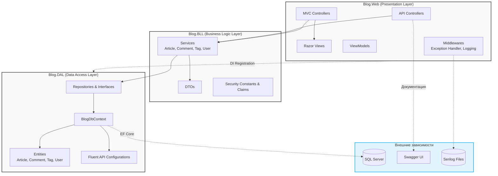

# 🌐 Blog3Tier

Веб-приложение для ведения блога, построенное на платформе ASP.NET Core (.NET 10) с четким разделением на три уровня: Presentation, Business Logic и Data Access. Проект предоставляет полноценный веб-интерфейс на Razor Views и RESTful API с документацией Swagger.

> Проект разработан в качестве дипломной работы, завершающей обучение на курсе SkillFactory.

## 📌 Назначение и ключевые возможности

Блог-платформа с разграничением прав доступа, где пользователи могут создавать статьи, оставлять комментарии и управлять тегами.

### Основной функционал

 - **Статьи** – полный CRUD, поиск по тексту, фильтрация по тегам, выборка по автору.
 - **Теги** – создание с фиксацией автора, связь «многие ко многим» со статьями, контроль уникальности.
 - **Комментарии** – добавление, встроенное (инлайн) редактирование и удаление прямо на странице статьи.

### Безопасность

 - Аутентификация через **ASP.NET Core Identity** с хешированием паролей.
 - Автоматическое назначение роли `Пользователь` при регистрации.
 - Разграничение доступа по ролям (`Администратор`, `Модератор`, `Пользователь`) и правам (Claims).
 - Серверная проверка владения объектом при редактировании и удалении (защита от подмены `AuthorId`).

### Интерфейс

 - Razor Views на **Bootstrap 5.3** для веб-интерфейса.
 - **Swagger UI** для интерактивной документации REST API.

## 🛠️ Стек технологий

 - **Платформа**: .NET 10 / C#
 - **Фреймворк**: ASP.NET Core MVC / Web API
 - **ORM**: Entity Framework Core (SQL Server)
 - **Аутентификация**: ASP.NET Core Identity (cookie)
 - **Документация API**: Swagger / OpenAPI (Swashbuckle)
 - **Логирование:** Serilog (консоль + файл с суточной ротацией)

## 🏗️ Архитектура решения

Проект построен по трехуровневой архитектуре с явным разделением ответственности:



#### Зависимости между слоями

 - **Blog.Web** зависит от **Blog.BLL** (сервисы и DTO) и от **Blog.DAL** (регистрация `DbContext` и репозиториев в DI-контейнере).
 - **Blog.BLL** зависит от **Blog.DAL** (интерфейсы репозиториев и сущности).
 - **Blog.DAL** не зависит от верхних слоев.

## 📁 Структура решения

```text
Blog3Tier/
 ├── Blog.sln
 ├── Blog.DAL/                    # Уровень доступа к данным
 │   ├── Configurations/          # Fluent API конфигурации (Article, Comment, Tag)
 │   ├── Entities/                # Сущности: Article, Comment, Tag, User
 │   ├── Migrations/              # Миграции EF Core
 │   ├── Repositories/            # Репозитории и их интерфейсы
 │   ├── BlogDbContext.cs         # Контекст базы данных
 │   └── Blog.DAL.csproj
 ├── Blog.BLL/                    # Уровень бизнес-логики
 │   ├── DTOs/                    # DTO для статей, комментариев, тегов, пользователей
 │   ├── Security/                # Константы безопасности (роли, права, JWT)
 │   ├── Services/                # Сервисы (Article, Comment, Tag, User)
 │   └── Blog.BLL.csproj
 └── Blog.Web/                    # Уровень представления
     ├── Controllers/             # MVC и API-контроллеры
     ├── Data/                    # Инициализатор базы данных (DbInitializer)
     ├── Middlewares/             # Глобальный обработчик исключений, логирование
     ├── Properties/              # launchSettings.json
     ├── ViewModels/              # Модели представления
     ├── Views/                   # Razor Views (Account, Home, Shared)
     ├── appsettings.json         # Конфигурация приложения
     ├── Program.cs               # Точка входа и настройка конвейера
     └── Blog.Web.csproj
```

#### Ключевые файлы

 - `Blog.Web/appsettings.json` – строка подключения к БД, настройки Serilog.
 - `Blog.Web/Program.cs` – регистрация сервисов, Identity, авторизации, middleware.
 - `Blog.Web/Data/DbInitializer.cs` – создание предустановленных ролей и учетных записей при первом запуске.
 - `Blog.DAL/Migrations/` – миграции EF Core для управления схемой БД.

## 🗃️ Модель данных

### Основные сущности

#### Article (Статья)

|Поле|Тип|Описание|
|-|-|-|
|Id|int (PK)|Идентификатор|
|Title|string|Обязательное, макс. 250 символов|
|Content|string|Обязательное|
|CreatedAt|DateTime|Дата создания|
|UpdatedAt|DateTime?|Дата последнего обновления|
|AuthorId|string (FK)|Ссылка на User|
|Author|navigation|Навигационное свойство|
|Tags|ICollection<Tag>|Связь «многие ко многим»|
|Comments|ICollection<Comment>|Комментарии к статье|

#### Comment (Комментарий)

|Поле|Тип|Описание|
|-|-|-|
|Id|int (PK)|Идентификатор|
|Content|string|Текст комментария|
|CreatedAt|DateTime|Дата создания|
|ArticleId|int (FK)|Ссылка на Article|
|Article|navigation|Навигационное свойство|
|AuthorId|string (FK)|Ссылка на User|
|Author|navigation|Навигационное свойство|

#### Tag (Тег)

|Поле|Тип|Описание|
|-|-|-|
|Id|int (PK)|Идентификатор|
|Name|string (unique)|Уникальное имя тега|
|CreatorId|string? (FK)|Ссылка на User|
|Creator|navigation|Навигационное свойство|
|Articles|ICollection<Article>|Связь «многие ко многим»|

#### User (Пользователь, расширяет IdentityUser)

|Поле|Тип|Описание|
|-|-|-|
|FirstName|string|Имя|
|LastName|string|Фамилия|
|RegisteredAt|DateTime|Дата регистрации|
|Articles|ICollection<Article>|Статьи пользователя|
|Comments|ICollection<Comment>|Комментарии пользователя|

### Связи

 - **Article** → **User** – «многие к одному», каскадное удаление (`DeleteBehavior.Cascade`).
 - **Article** ↔ **Tag** – «многие ко многим» через промежуточную таблицу `ArticleTags`.
 - **Comment** → **Article** – «многие к одному».
 - **Comment** → **User** – «многие к одному».

> `BlogDbContext` наследует `IdentityDbContext` и применяет все конфигурации из текущей сборки через `ApplyConfigurationsFromAssembly`.

## 🚀 Быстрый старт

### Требования

 - **.NET SDK 10** – целевой фреймворк проектов `net10.0`.
 - **SQL Server** (LocalDB, Express или полноценный экземпляр). В строке подключения по умолчанию используется `.\SQLEXPRESS`.
 - **Entity Framework Core Tools** (опционально, для работы с миграциями):

```bash
dotnet tool install --global dotnet-ef
```

### 1. Клонирование репозитория

```bash
git clone https://github.com/maexdenton/CDEV-Homework-Final-Project.git
cd CDEV-Homework-Final-Project/Blog3Tier
```

### 2. Настройка строки подключения

Откройте файл `Blog.Web/appsettings.json` и при необходимости измените строку подключения `DefaultConnection` в соответствии с вашей конфигурацией SQL Server:

```json
"ConnectionStrings": {
  "DefaultConnection": "Server=.\\SQLEXPRESS;Database=Blog3TierDb;Trusted_Connection=True;MultipleActiveResultSets=true;TrustServerCertificate=True"
}
```

> 🔐 Безопасность: для production задавайте строку подключения через переменные окружения или user-secrets, не храните ее в репозитории.

### 3. Сборка и запуск

```bash
# Восстановление зависимостей
dotnet restore

# Сборка проекта
dotnet build

# Запуск приложения
dotnet run --project Blog.Web

# Запуск в режиме наблюдения (hot reload)
dotnet watch --project Blog.Web
```

При первом запуске база данных `Blog3TierDb` создается и мигрирует автоматически.

### 4. Доступные URL

После запуска приложение будет доступно по адресам:

 - Веб-интерфейс: https://localhost:7133/
 - Swagger UI: https://localhost:7133/swagger

## 🔐 Предустановленные учетные записи

После инициализации базы данных доступны две учетные записи:

|Роль|Логин|Пароль|
|-|-|-|
|Администратор|admin@blog.local|Admin123!|
|Модератор|moderator@blog.local|Moderator123!|

> ⚠️ Внимание: учетные данные приведены исключительно для локальной разработки и тестирования.

## 📡 API Reference

Все API-маршруты требуют аутентификации (кроме регистрации и публичных GET-запросов). Аутентификация выполняется через сессионные cookie, настроенные в приложении.

### Пользователи (`/api/user`)

|Метод|Маршрут|Описание|Доступ|
|-|-|-|-|
|`POST`|`/api/user/register`|Регистрация пользователя|Анонимный|
|`GET`|`/api/user`|Список пользователей|Только Администратор (`AppPermissions.UsersView`)|
|`GET`|`/api/user/{id}`|Профиль пользователя|Владелец или Администратор|
|`PUT`|`/api/user/{id}`|Обновление профиля|Владелец или Администратор|
|`DELETE`|`/api/user/{id}`|Удаление пользователя|Только Администратор (`AppPermissions.UsersDelete`)|

### Статьи (`/api/article`)

|Метод|Маршрут|Описание|Доступ|
|-|-|-|-|
|`GET`|`/api/article`|Список статей (с фильтрацией по `search` и `tag`)|Анонимный|
|`GET`|`/api/article/{id}`|Статья по ID|Анонимный|
|`GET`|`/api/article/author/{authorId}`|Статьи автора|Анонимный|
|`POST`|`/api/article`|Создание статьи|`AppPermissions.ArticlesCreate`|
|`PUT`|`/api/article/{id}`|Обновление статьи|`AppPermissions.ArticlesUpdate`|
|`DELETE`|`/api/article/{id}`|Удаление статьи|`AppPermissions.ArticlesDelete`|


### Комментарии (`/api/comment`)

|Метод|Маршрут|Описание|Доступ|
|-|-|-|-|
|`GET`|`/api/comment`|Список комментариев|Анонимный|
|`GET`|`/api/comment/{id}`|Комментарий по ID|Анонимный
|`POST`|`/api/comment`|Создание комментария|`AppPermissions.CommentsCreate`|
|`PUT`|`/api/comment/{id}`|Обновление комментария|`AppPermissions.CommentsUpdate`|
|`DELETE`|`/api/comment/{id}`|Удаление комментария|`AppPermissions.CommentsDelete`|

### Теги (`/api/tag`)
|Метод|Маршрут|Описание|Доступ|
|-|-|-|-|
|`GET`|`/api/tag`|Список тегов|Анонимный|
|`GET`|`/api/tag/{id}`|Тег по ID|Анонимный|
|`POST`|`/api/tag`|Создание тега|`AppPermissions.TagsCreate`|
|`PUT`|`/api/tag/{id}`|Обновление тега|`AppPermissions.TagsUpdate`|
|`DELETE`|`/api/tag/{id}`|Удаление тега|`AppPermissions.TagsDelete`|

### Примеры запросов

#### Регистрация пользователя:

```bash
curl -X POST https://localhost:7133/api/user/register \
  -H "Content-Type: application/json" \
  -d '{"email":"user@example.com","password":"User123!","userName":"newuser"}'
```

#### Получение списка статей с фильтрацией:

```bash
curl -X GET "https://localhost:7133/api/article?search=example&tag=tech"
```

#### Создание статьи (требуется аутентификация):

```bash
curl -X POST https://localhost:7133/api/article \
  -H "Content-Type: application/json" \
  -H "Cookie: .AspNetCore.Identity.Application=<ваша_сессионная_cookie>" \
  -d '{"title":"Новая статья","content":"Текст статьи","tags":["tech","news"]}'
```

#### Удаление комментария (требуется владение или роль модератора/администратора):

```bash
curl -X DELETE https://localhost:7133/api/comment/5 \
  -H "Cookie: .AspNetCore.Identity.Application=<ваша_сессионная_cookie>"
```

> 💡 Примечание: для получения cookie необходимо предварительно выполнить вход через веб-интерфейс. Полный перечень маршрутов и параметров доступен в Swagger UI.

## 🔒 Аутентификация и авторизация

### Аутентификация

 - Реализована через **ASP.NET Core Identity** с хешированием паролей.
 - Настроены параметры пароля: минимальная длина 6 символов, без требований к цифрам, регистру и спецсимволам.
 - При регистрации автоматически назначается роль `Пользователь`.
 - Используются сессионные cookie. Настроены пути перенаправления: `/Account/Login` и `/Error/403`.

> JWT: в `SecurityConstants.cs` присутствуют константы для JWT (issuer, audience, время жизни токенов), однако в текущей версии JWT не используется – это задел на возможное будущее развитие проекта.

### Ролевая модель

|Роль|Статьи и комментарии|Теги|Пользователи и роли|
|-|-|-|-|
|Администратор|Полный доступ ко всем|Полный доступ ко всем|Полный доступ (`Permissions.Roles.Manage`)|
|Модератор|Редактирование и удаление любых|Только просмотр и создание|Нет доступа|
|Пользователь|Создание; редактирование/удаление только своих|Редактирование/удаление только своих|Только свой профиль|
|Гость|Только просмотр|Только просмотр|Регистрация и вход|

### Защита от подмены авторства

При создании статей, комментариев и тегов идентификатор автора всегда берется из claims текущего пользователя, а не из тела запроса. При обновлении и удалении выполняется серверная проверка владения объектом или наличия повышенных прав.

## ⚙️ Конфигурация

### Переменные окружения

Приложение использует стандартные переменные окружения ASP.NET Core: 

 - `ASPNETCORE_ENVIRONMENT` – устанавливает окружение (`Development`, `Production`).
 - `ConnectionStrings__DefaultConnection` – позволяет переопределить строку подключения без изменения файла конфигурации.

#### Пример запуска с переопределением строки подключения:

```bash
ConnectionStrings__DefaultConnection="Server=...;Database=...;..." dotnet run --project Blog.Web
```

## 🧬 EF Core миграции

Для управления схемой базы данных используются миграции Entity Framework Core. Команды выполняются из корневой папки `Blog3Tier`: 

```bash
# Добавление новой миграции
dotnet ef migrations add <имя_миграции> --project Blog.DAL --startup-project Blog.Web

# Применение миграций вручную (если не используется автоматическое применение)
dotnet ef database update --project Blog.DAL --startup-project Blog.Web
```

## 🧪 Тестирование

В репозитории **отсутствуют** проекты с автоматическими тестами (юнит-тестами или интеграционными тестами).

Если вы планируете добавить тесты, рекомендуется создать отдельный проект (например, Blog.Tests) и использовать фреймворки xUnit или NUnit.

## 🩺 Диагностика и устранение неполадок

### `SqlException: Cannot open database requested by the login`

 - Убедитесь, что служба SQL Server (`MSSQL$SQLEXPRESS`) запущена в диспетчере служб Windows.
 - Проверьте корректность имени инстанса в строке подключения `DefaultConnection`.

### `SqlException (1785): Introducing FOREIGN KEY constraint may cause cycles or multiple cascade paths`

 - Конфигурация внешних ключей в `CommentConfiguration.cs` настроена с `DeleteBehavior.Restrict` для связи комментария с пользователем.
 - Убедитесь, что миграции не переопределяют данное поведение.

### Ошибки `401 Unauthorized` / `403 Forbidden` в API

 - `401 Unauthorized` – отсутствие сессионной cookie или заголовка аутентификации.
 - `403 Forbidden` – попытка изменить чужой ресурс без обладания ролью «Модератор» или «Администратор».
